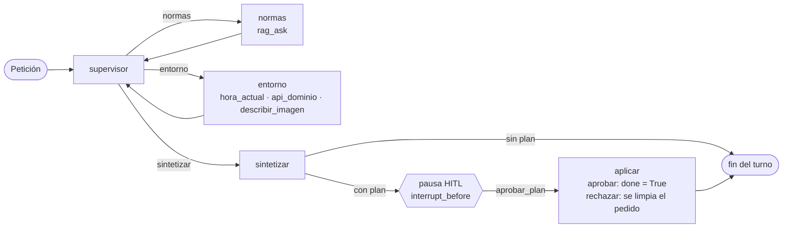

# Agente del Parque de El Retiro

## Qué es
Es un agente construido con LangGraph sobre el Parque de El Retiro (Madrid).
- Responde preguntas sobre el parque: historia, lugares, servicios y normas.
- Propone planes de visita. Una persona los aprueba o los rechaza antes de darlos por cerrados.
- Se apoya en el RAG del Project Break 1, documentado en [docs/rag_base.md](docs/rag_base.md).

## Arquitectura



- **Supervisor:** elige la ruta con el LLM. Si el LLM falla o propone una ruta no válida, usa un fallback determinista.
- **Límites:** `MAX_ITER` y `MAX_STEPS_ESPECIALISTA`, definidos en `config.py`.
- **Persistencia:** el grafo usa `MemorySaver`; cada conversación tiene su `thread_id`.
- **Quién decide:** Python decide `done`, nunca el LLM.

| Bloque | Archivos |
|---|---|
| Núcleo | `src/graph.py`, `src/agent.py`, `src/state.py` |
| Tools | `src/tools/` |
| Interfaces | `main_agent.py` (CLI), `app_agent.py` y `src/ui_agente.py` (Streamlit) |

Las interfaces solo usan dos funciones: `procesar_turno` y `aprobar_plan`. El contrato entre bloques está en [docs/contrato.md](docs/contrato.md).

## Requisitos e instalación
Necesitas Python 3.10 o superior.

```bash
git clone https://github.com/adxalex/retiro_agents
cd retiro_agents
python -m venv .venv
```

Activa el entorno: `source .venv/bin/activate` en Linux o macOS, `.venv\Scripts\Activate.ps1` en PowerShell. Después:

```bash
pip install -r requirements.txt
pip install -r requirements-dev.txt   # solo para ejecutar los tests
python -m scripts.download_index      # índice Chroma preconstruido, no gasta API
```

**Claves.** Copia `.env.example` como `.env` y completa las claves. El archivo `.env` nunca se sube al repositorio.

```bash
cp .env.example .env        # en Windows: copy .env.example .env
```

| Variable | Para qué sirve |
|---|---|
| `GEMINI_API_KEY` | LLM y embeddings. El RAG también acepta `GOOGLE_API_KEY`, pero `describir_imagen` solo lee `GEMINI_API_KEY`. |
| `AEMET_API_KEY` | Datos de AEMET. Sin ella, `api_dominio` usa el JSON local de respaldo. |

## Cómo ejecutarlo
Todos estos comandos gastan API de Gemini.

| Interfaz | Comando |
|---|---|
| CLI, modo interactivo (por defecto) | `python main_agent.py` o `python main_agent.py --modo interactivo` |
| CLI, demo con un ejemplo preparado | `python main_agent.py --modo demo` |
| Streamlit | `streamlit run app_agent.py` |

Cómo funciona la aprobación humana (HITL):
1. Si el agente puede proponer un plan concreto, lo muestra y el grafo se detiene antes de aplicarlo.
2. Mientras el plan está pendiente, no se aceptan peticiones nuevas en esa conversación.
3. La persona aprueba o rechaza el plan.
   - En Streamlit, ambas decisiones admiten un comentario opcional.
   - En la CLI, solo el rechazo pide comentario.
4. Al aprobar, `done = True`. Al rechazar, el plan se descarta y la conversación sigue en el mismo `thread_id`.

La demo de la CLI aprueba automáticamente. Esa aprobación solo existe en ese modo y pasa por `aprobar_plan`.

## Tools

| Tool | Qué hace |
|---|---|
| `rag_ask` | Responde con el RAG del parque, con fuentes, citas y abstención. |
| `api_dominio` | Trae observaciones, previsiones y avisos de AEMET para el Retiro. |
| `hora_actual` | Da la hora de Madrid y si el parque está abierto, según el horario de `config.py`. |
| `describir_imagen` | Describe con Gemini una imagen PNG o JPEG adjunta. |

- **Allowlist:** `ejecutar_tool` (`src/tools/__init__.py`) solo ejecuta esas cuatro tools. Cualquier otro nombre devuelve `status = "blocked"`.
- **Salida homogénea:** las tools nunca lanzan excepciones. Siempre devuelven `ok`, `error` o `blocked`, con un evento de traza.
- **Respaldo de AEMET:**
  - Si AEMET falla, `api_dominio` lee las observaciones de `src/tools/fallback/aemet.json`.
  - El campo `origen` indica de dónde vienen los datos: `aemet` o `respaldo`.
  - Si previsiones o avisos no están disponibles, valen `None`.

## Tests

```bash
pytest
```

Los tests no llaman a Gemini, a AEMET ni a la red: usan dobles y un LLM falso. Comprobado el 25/10/2026 sobre `develop` (commit `d163fb0`): **507 passed**.

## Cómo se trabajó
El equipo usó desarrollo guiado por especificaciones (SDD): cada funcionalidad pasa por spec, plan, tareas, implementación y validación, siempre con tests primero. Ver [specs/](specs/) y [docs/constitution.md](docs/constitution.md). Cada bloque se desarrolló en su propia rama, con un PR a `develop`.

## Límites conocidos
- **Itinerario repetido:** puede aparecer dos veces en el chat. El núcleo lo incluye en la respuesta y la interfaz lo pinta otra vez como lista a partir del campo `plan`.
- **`avisos = None`:** desde el PR #16, el prompt del especialista `entorno` indica que `None` significa "no disponible" (commit `1017d75`, ya en `develop`). Depende del LLM y no hay ningún test que lo compruebe.
- **Traza sin bytes:** que la traza no lleve los bytes de la imagen (`_args_para_traza` en `src/graph.py`) no tiene test propio. La allowlist de `ejecutar_tool` sí lo tiene desde el PR #15 (`tests/test_init.py`).
- **Memoria de las conversaciones:** dura lo que dura el proceso, porque `MemorySaver` no guarda nada en disco.

## Documentación
- [docs/contrato.md](docs/contrato.md): contrato entre bloques.
- [docs/constitution.md](docs/constitution.md): principios del proyecto.
- [entregables/informe_decisiones.md](entregables/informe_decisiones.md): decisiones del agente (PB2).
- [docs/rag_base.md](docs/rag_base.md): RAG base (PB1).
- [specs/](specs/): especificaciones, planes, tareas y validaciones.

## Equipo
- Mihaela: núcleo del agente.
- Guillermo: tools.
- Adixon: interfaz y contrato.
